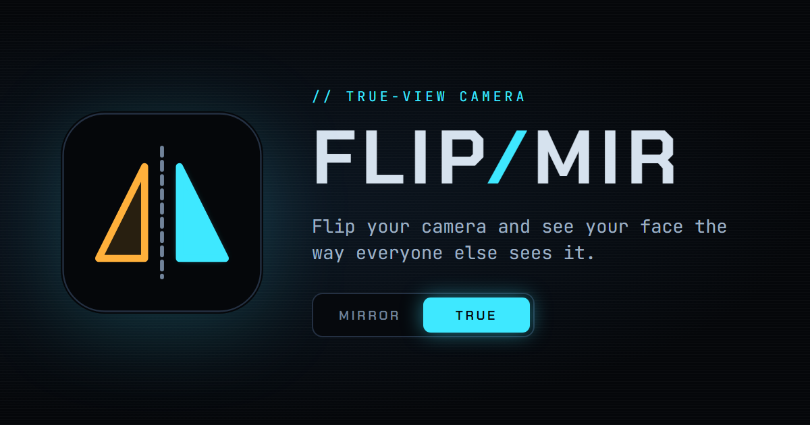

<p align="center"></p>

# FlipMir

Your phone's selfie camera and every video-call preview show you mirrored. Everyone else sees the other way round. FlipMir flips the camera back so you can see your face the way other people do, and switch between the two views whenever you like.

**Live:** https://gchinmayvarma.github.io/flip-mir/

## Features

- **Mirror / True switch** that stays on screen. Double-tap the video or press `F` to flip as well.
- **Both views at once.** Side by side on wide screens, stacked on a phone held upright.
- **Camera picker** for every camera the browser can see, with 480p to 4K resolution.
- **Look controls:** filters (Clean, Vivid, Soft, Noir, Night-vis, X-ray), brightness, contrast, saturation and warmth.
- **Guides:** a centre line for comparing the two sides of your face, a thirds grid, and HUD scanlines.
- **Screen ring light** that turns the screen edge into a white or warm light for dark rooms.
- **Photos** that keep your flip and filters, with Save, plus Share on phones.
- **Installable app.** Add it to your home screen or desktop, and it keeps working offline.
- Settings are remembered on the device, and the screen stays awake while the page is open.

Everything runs in the browser. Video never leaves your device.

## Keys

| Key | Action |
| --- | --- |
| `F` | Flip mirror / true |
| `S` | Show both views |
| `P` | Take a photo |
| `T` | Open or close the Tune panel |
| `C` | Next camera |
| `Esc` | Close panels |

## Running locally

Browsers only allow the camera on `https://` pages or `localhost`. To run it from a local copy:

```sh
npx serve .
# or
python -m http.server 8000
```

Then open `http://localhost:8000`. Opening `index.html` directly also works in Chrome and Edge, but the offline/install features need a server.

## Files

| Path | What it is |
| --- | --- |
| `index.html` | The whole app: markup, styles and script |
| `sw.js` | Service worker for offline use. Bump `VERSION` when app files change. |
| `manifest.webmanifest` | Install metadata and icons |
| `icons/` | App icons (`icon.svg` and `maskable.svg` are the sources for the PNGs) |
| `og.png` | Link preview image |
